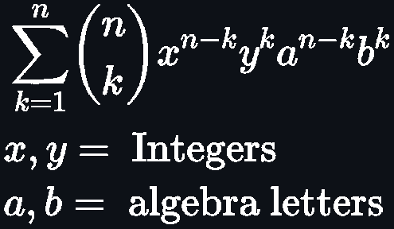

# Binomial Theorem

This program develops any powered binomial to its expanded form, exactly.
The multipliers can be integers, decimals or fractions, positive or negative. `n` must be a whole number, 0 or more, because that is what the theorem says.

The binomial theorem (with multipliers added in) is defined by this formula:<br>
```math
\begin{equation}
\begin{aligned}
& (xa + yb)^n = \sum_{k=0}^n\left(\begin{array}{l}
n \\
k
\end{array}\right) x^{n-k} y^k a^{n-k} b^k \\
& x, y=\text { numbers (integers, decimals or fractions) } \\
& a, b=\text { algebra letters }
\end{aligned}
\end{equation}
```
<!--  -->

# Usage

Needs Python 3.10 or newer and nothing else.

```bash
python binomial_theorem.py              # interactive mode
python binomial_theorem.py 2 -3 5       # (2a - 3b)⁵ = 32a⁵ - 240a⁴b + 720a³b² - 1080a²b³ + 810ab⁴ - 243b⁵
python binomial_theorem.py 0.5 0.25 3   # (0.5a + 0.25b)³ = 0.125a³ + 0.1875a²b + 0.09375ab² + 0.015625b³
python binomial_theorem.py -1/3 1 2     # (-(1/3)a + b)² = (1/9)a² - (2/3)ab + b²
```

It can also be imported: `solve(x, y, n)` returns the line as a string, `terms(x, y, n)` yields the terms one by one, and `x`/`y` may be `int`, `Fraction`, `Decimal` or a `(numerator, denominator)` pair.

# How it works

- **Exact arithmetic.** Integer and decimal multipliers give exact decimals; other fractions (like 1/3) give reduced fractions. Nothing is rounded.
- **No factorials.** Each coefficient comes from the previous one: `term(k+1) = term(k) · (n-k)/(k+1) · y/x`. With the multipliers scaled to integers that is one multiplication and one exact division by a small number per term, which is linear in the size of the term. For fractions that never terminate, the running fraction stays reduced using only gcds against that small factor.
- **Fast printing.** The big numbers are `Decimal` integers instead of `int`, because Python converts an `int` to text in quadratic time; `Decimal` already stores decimal digits, so printing is linear. That alone is a 15× difference at n = 10 000.
- **Symmetry.** When |x| = |y|, like in (a + b)ⁿ, term n-k equals term k, so the second half is reused instead of computed (within a fixed memory budget).
- **Streaming.** Terms are written as soon as they are ready, so memory stays small even when the output is gigabytes.
- **Fast start.** Only light modules are imported, because for normal sizes starting Python is most of the time.

Total work is proportional to the number of digits printed, so it can't be fundamentally beaten. Timings for `python binomial_theorem.py 2 3 n > /dev/null`:

| n      | output size | time   |
|-------:|------------:|-------:|
| 10     | 0.2 KB      | 0.02 s |
| 1 000  | 0.6 MB      | 0.06 s |
| 10 000 | 61 MB       | 0.27 s |
| 30 000 | 546 MB      | 1.9 s  |

# Tests

```bash
python -m unittest
```

They check every result against slow, obviously-correct polynomial multiplication, plus closed-form checks for large n.

# History

[The first version](https://github.com/SirenityK/Binomial-Theorem/blob/a0e4138/Binomial%20Theorem.py) used floats, so it stopped at n = 1029 and printed approximations: for (1.1a + b)⁴⁰⁰ it gave `1555767590778281984a⁹b³⁹¹`, while the exact coefficient is `1555767590778280745.1230116`. This version has no limit on n and every digit is exact.

# Motivations

Make a list of programs which makes you the homework without doing anything by your own, just with a little time writing code.

Before starting to code I used to study a lot of math and any other science topic by my own will. But I never found a really good way to apply that knowledge in neither my diary life nor future, so I started learning programming for that and it is incredible. I've been learning programming for 3 weeks on the date I upload this.

This program is made for learning purposes. If you think you can make it better, tiny, readable, etc and you do it, please let me know, this way I will learn more and I will thank you.
